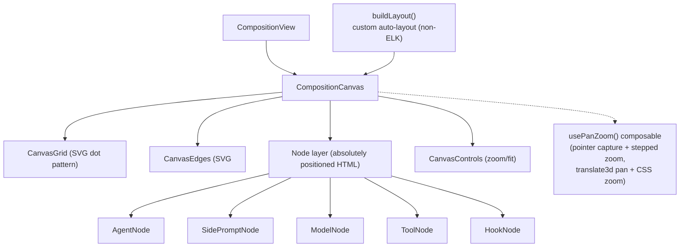

# ADR-005: Composition Canvas - Custom SVG, Not a Graph Library

- Status: Accepted, **amended 2026-07-30** (see Amendment at the end - zoom is the CSS `zoom` property, and node types are resolved through a registry)
- Context: The heart of swarmy_ui is the agent composition canvas on `/agents`: agent cards with attached model nodes, tool nodes (tool/prompt/subagent/handoff/provider/mcp), hook nodes, side A/B participant nodes, bezier edges, groups, pan/zoom, and an auto-layout algorithm. We evaluated graph libraries (Vue Flow, vue-nodus) against building it ourselves.

## Decision

Build the canvas as custom Vue 3 components + SVG, with no graph library dependency.

## Architecture



### Domain model

```ts
interface CompositionLayout {
  nodes: CanvasNode[];   // agent | side | tool | hook | model
  edges: CanvasEdge[];   // { id, from, to, kind?: 'model'|'structural', sideId?, toolKind? }
  groups: CanvasGroup[]; // subagent groupings { resumable?, multiInstance? }
  bounds: { x: number; y: number; width: number; height: number };
}
```

- Nodes are HTML (not SVG) so they can host full form UI inside canvas cards; only edges and the grid are SVG.
- A `Map<string, Measurement>` of measured node sizes feeds edge anchoring (`modelAnchorY`, per-kind `toolColumns` offsets).
- `buildLayout(agent, sideCompositions, subagentCompositions, models, toolsCatalog)` places nodes with internal heuristics; model nodes use `outboard-left`, `outboard-right`, or `below-row` placement.

### Why not Vue Flow

1. The interaction model is bespoke: per-kind edge anchoring (model anchor points, tool columns), snap sections, measured HTML nodes with forms inside.
2. Layout is a custom algorithm regardless of library; a library only buys pan/zoom, which is ~100 lines with pointer capture and CSS transforms.
3. Node rendering needs full HTML forms and container-query responsive cards, which fight against canvas/SVG-first node abstractions.
4. Zero dependency surface: the canvas is the most product-defining surface of swarmy_ui and must be fully skinnable and behavior-controlled.

## Swappability

- Node components (`ModelNode`, `ToolNode`, ...) receive typed data props and emit events. Their internal appearance is pure skin: a redesign rewrites the node components without touching layout, edges, or CompositionView.
- Edge styling (color, dash, width per kind) reads from the token system (`--agents-accent-*`).
- If the team later wants a library, the seam is `CompositionCanvas` + `usePanZoom`: the domain model and node components survive the swap.

## Consequences

- Highest-effort component in the app (estimate 2-4 weeks).
- Must implement: pan/zoom, node measurement, edge routing (cubic bezier with per-kind anchors), group bounds, fit-to-content, and the auto-layout heuristic.
- Vue Flow remains the documented fallback if schedule forces an accelerator.

## Amendment - 2026-07-30 (capture reconciliation, see ADR-009)

The decision to build the canvas ourselves stands, and so does every reason for
it. Two mechanics in the text above are wrong against the live app.

**1. Zoom is the CSS `zoom` property, not `transform: scale()`.** The transform
layer is `absolute origin-top-left will-change-transform` with:

```css
transform: translate3d(tx, ty, 0);   /* pan  */
zoom: <scale>;                       /* zoom */
transform-origin: 0 0;
transition: opacity 200ms ease-out;
```

Pan is compositor-only; zoom re-runs layout, which is why node text is crisp at
11% and at 51%. `usePanZoom` must therefore expose pan and zoom as separate
outputs, and screen-to-canvas math must account for `zoom` already being applied
to child `getBoundingClientRect()` results - measured node sizes come back in
zoomed pixels and must be divided by the zoom before they enter the layout model.
Zoom is stepped (`+`/`-` in ~4-point increments, a fourth fit-to-screen button),
not continuous. Default view is fit-to-content: 11% for the reference agent.
Full detail in `specs/composition-canvas/panzoom.md` and ADR-009 Decision 3.

**2. Node components are resolved through a registry, not a `v-if` chain.** Six
kinds render today (`agent`, `prompt`, `function`, `subagent`, `human`, `model`).
The node layer looks the component up by `node.kind` in the `canvasNodes`
registry (ADR-008 seam 3). A new node kind is a plug, not an edit to the node
layer. This is the mechanism that the "Swappability" section above was asserting
without one.

**3. Edges are orthogonal polylines, not beziers, and they are all one colour.**
The "cubic bezier with per-kind anchors" in the Consequences above is wrong.
Sampled from `structure-canvas-zoom50-light.png`: every edge is an orthogonal
polyline with rounded elbows, and every sampled edge pixel is the same neutral
(~`#dcdcdc`). Only *dashing* distinguishes a model edge. The side-A / side-B
accents (sky `#00a6f4`, amber `#fe9a00`) are real, but they appear on **card
borders**, never on edges. Paths stamp `data-edge-id`, `data-edge-kind` and
`data-edge-tool-kind`.

**4. The dot grid is screen-space.** Measured identical at 11% and at 51%, so
the grid pattern is not inside the zoomed layer. The 20x20 group sub-grid *is*
in-layer and does scale; they are two different patterns and must not be
unified.

**5. Canvas chrome, measured.** Viewport `relative flex-1 overflow-hidden
bg-neutral-100/50 dark:bg-neutral-950/50`, inner `absolute inset-0 cursor-grab`.
Dot grid is an inline SVG `<pattern id="canvas-dot-grid" width=24 height=24>`
with `<circle cx=12 cy=12 r=1 class="fill-neutral-400/20">`; group sub-grids use
a 20x20 pattern with `r=0.75` at `/15`. Groups are `[data-canvas-group]` with
`bg-[#f7f7f7] dark:bg-[#1e1e1e]` and an 8px radius. The live DOM carries
`data-canvas-node`, `data-canvas-node-id`, `data-canvas-group`,
`data-canvas-model-node`, `data-edge-id`, `data-edge-kind`,
`data-edge-tool-kind`, `data-model-anchor`, `data-variables-section` and
`data-tool-column`; keep those names, they are the test and measurement handles.
