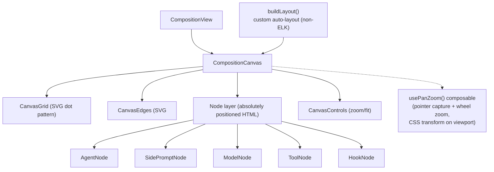

# ADR-005: Composition Canvas - Custom SVG, Not a Graph Library

- Status: Accepted
- Context: The heart of swarmy_ui is the agent composition canvas on `/agents`: agent cards with attached model nodes, tool nodes (tool/prompt/subagent/handoff/provider/mcp), hook nodes, side A/B participant nodes, bezier edges, groups, pan/zoom, and an auto-layout algorithm. We evaluated graph libraries (Vue Flow, vue-nodus) against building it ourselves.

## Decision

Build the canvas as custom Vue 3 components + SVG, with no graph library dependency.

## Architecture



### Domain model

```ts
interface CompositionLayout {
  nodes: CanvasNode[];   // agent | side | tool | hook | model
  edges: CanvasEdge[];   // { id, from, to, kind?: 'model'|'structural', sideId?, toolKind? }
  groups: CanvasGroup[]; // subagent groupings { resumable?, multiInstance? }
  bounds: { x: number; y: number; width: number; height: number };
}
```

- Nodes are HTML (not SVG) so they can host full form UI inside canvas cards; only edges and the grid are SVG.
- A `Map<string, Measurement>` of measured node sizes feeds edge anchoring (`modelAnchorY`, per-kind `toolColumns` offsets).
- `buildLayout(agent, sideCompositions, subagentCompositions, models, toolsCatalog)` places nodes with internal heuristics; model nodes use `outboard-left`, `outboard-right`, or `below-row` placement.

### Why not Vue Flow

1. The interaction model is bespoke: per-kind edge anchoring (model anchor points, tool columns), snap sections, measured HTML nodes with forms inside.
2. Layout is a custom algorithm regardless of library; a library only buys pan/zoom, which is ~100 lines with pointer capture and CSS transforms.
3. Node rendering needs full HTML forms and container-query responsive cards, which fight against canvas/SVG-first node abstractions.
4. Zero dependency surface: the canvas is the most product-defining surface of swarmy_ui and must be fully skinnable and behavior-controlled.

## Swappability

- Node components (`ModelNode`, `ToolNode`, ...) receive typed data props and emit events. Their internal appearance is pure skin: a redesign rewrites the node components without touching layout, edges, or CompositionView.
- Edge styling (color, dash, width per kind) reads from the token system (`--agents-accent-*`).
- If the team later wants a library, the seam is `CompositionCanvas` + `usePanZoom`: the domain model and node components survive the swap.

## Consequences

- Highest-effort component in the app (estimate 2-4 weeks).
- Must implement: pan/zoom, node measurement, edge routing (cubic bezier with per-kind anchors), group bounds, fit-to-content, and the auto-layout heuristic.
- Vue Flow remains the documented fallback if schedule forces an accelerator.
