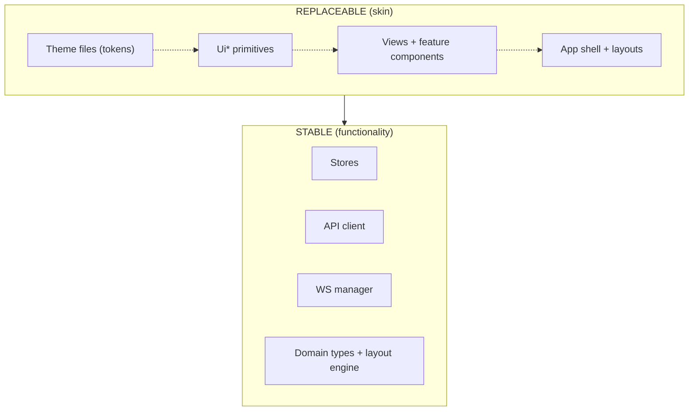

# ADR-007: The Swappability Principle (CORE DECISION)

- Status: Accepted, **amended 2026-07-30** (see Amendment at the end - the five seams gained a registration mechanism in ADR-008 and an elevation seam in ADR-009)
- Context: swarmy_ui's defining constraint: **any part of the UI layer - theme, colors, component appearance, layout, even the entire skin - must be replaceable without touching functionality.** Business logic, data flow, and behavior are stable; everything the user sees is a replaceable surface.

## Decision

Every architectural boundary in swarmy_ui is drawn so that appearance depends on stable abstractions, never the reverse. Concretely, five seams:

## Seam 1 - Tokens (theme swap)

All visual constants live in Tailwind v4 `@theme` CSS custom properties, in three layers: primitives -> semantic -> component. Components reference semantic utilities only. A new theme is a new CSS file. See ADR-001 and docs/design/theming.md.

## Seam 2 - The `Ui*` primitive layer (component skin swap)

All buttons, badges, tooltips, dropdowns, alerts, form wrappers, and empty states are implemented exactly once in `src/components/ui/`. Everything above composes these; nothing re-styles raw elements. Reskinning every button in the app = editing one file.

Rule: **no feature component may apply color, radius, shadow, or font utilities to a raw HTML element when a `Ui*` primitive exists for that purpose.**

## Seam 3 - Props/events contract (appearance vs behavior)

Feature components receive typed domain props and emit intent events. They never call the API and never read route params. Example:

```vue
<ModelNode
  :model="modelNodeData"
  :selected="isSelected"
  @select="..."
  @edit="..."
  @remove="..."
/>
```

A completely different visual implementation of `ModelNode` honors the same props/events and drops into the canvas unchanged.

## Seam 4 - Store-only networking (UI swap)

All data access is behind stores (ADR-006). A view is a pure projection of store state. This means the entire component tree above the stores can be deleted and rebuilt - a new shell, new views, new layout - against the same stores with zero changes to data flow.



## Seam 5 - Imperative surfaces (layout swap)

Modals and edit panes are mounted through `EditSurfaceHost` from the uiStore modal stack, not embedded inline. Any edit surface can be re-presented (dialog -> slide pane -> drawer) by changing the host and shell components only; the feature that opens it is untouched. Pane sizes and the 3-column composition layout come from uiStore values and CSS, not from view logic.

## Enforcement

| Rule | Enforced by |
|------|-------------|
| No hardcoded color/radius/font values | Lint rule banning arbitrary color utilities + code review |
| Feature components only compose `Ui*` primitives | Import boundary lint (`components/ui` is the only leaf styling module) |
| Components never import `lib/api` or `lib/ws` | Import boundary lint |
| Views never import other views | Import boundary lint |
| Domain props typed, events explicit | TypeScript |

## Consequences

- Slightly more indirection up front (primitive components for everything, store actions for every network call).
- The payoff: re-theming is a CSS task; reskinning is a single-directory task; a full UI redesign touches no store, no API code, and no domain logic. This is the property every other ADR protects.

## Amendment - 2026-07-30

The five seams stand unchanged. Two things were missing.

**1. Seams 2, 3 and 5 had no mechanism.** "A different visual implementation of
`ModelNode` drops into the canvas unchanged" was true of the props contract and
false of the wiring, because a `v-if` chain still named the component. ADR-008
adds four registries - views, inspector tabs, canvas node types, list column
sets - so a replacement or an addition registers itself instead of being named by
core. The enforcement table below gains a row:

| Rule | Enforced by |
|------|-------------|
| Core never imports a feature module | Import boundary lint (`src/router`, `src/components/ui` and shell components may not import `src/features/**`) |

**2. Elevation was an unowned seam.** Depth is not a Tailwind `shadow-*`
utility in this product; it is a painted canvas hatch behind a single
`DropShadow` component (ADR-009 Decision 2). That makes elevation a Seam 2
primitive like any other: re-elevating the whole app is one component plus its
tokens. The Seam 2 rule now reads: no feature component may apply colour, radius,
**shadow/elevation**, or font utilities to a raw HTML element when a `Ui*`
primitive exists for that purpose.

**3. Fidelity outranks taste, for now.** ADR-009 makes `exact-tokens.md`
authoritative and forbids aesthetic improvement during the replica build. That
is not in tension with swappability - it is the payoff. Because every captured
value lands in a token and every captured surface lands in a primitive, the
first deliberate redesign is a token and primitive edit, not a rewrite.
