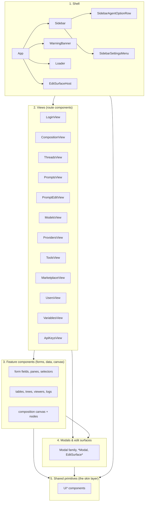

# swarmy_ui - Component Tree

~170 components organized into five layers. The layering is load-bearing: it is what makes the UI swappable (ADR-007). A component may only depend on layers at or below its own level. Views never import views; everything visual bottoms out in the `Ui*` primitives.

## Layer 1 - Shell (7)

| Component | Responsibility |
|-----------|---------------|
| `App` | Root; selects public vs guarded layout; mounts chrome |
| `Sidebar` | Global navigation rail; reads agents list for quick links |
| `SidebarAgentOptionRow` | Single agent quick-link row in nav |
| `SidebarSettingsMenu` | Settings flyout (users, variables, api-keys) |
| `WarningBanner` | Global dismissible warning strip |
| `Loader` | Boot/route spinner |
| `EditSurfaceHost` | Imperative host that mounts modals/slide-panes from the uiStore modal stack |

## Layer 2 - Views (15)

| View | Route | Composes |
|------|-------|----------|
| `LoginView` | `/login` | UiFormField, UiButton, authStore |
| `CompositionView` | `/agents` | StructureTree, CompositionCanvas, Thread*Pane family, InspectorPanel |
| `ThreadsView` | `/threads`, `/threads/:id` | ThreadListPane, ThreadInspectorPane |
| `PromptsView` | `/prompts` | PromptsDataTable, PromptCard, PromptModal |
| `PromptEditView` | `/prompts/:id` | Prompt*Pane family, CodeEditor |
| `ModelsView` | `/models` | ModelPane, ModelModal, SelectableCardList |
| `ProvidersView` | `/providers` | SelectableCardList, provider tool panes |
| `ToolsView` | `/tools` | FunctionToolCard, tool detail panes |
| `MarketplaceView` | `/marketplace`, `/marketplace/:name(.*)` | MarketplaceCard, MarketplaceDetail, PackModal, UnpackModal |
| `UsersView` | `/settings/users` | DataTable, user CRUD forms |
| `VariablesView` | `/settings/my-variables`, `/settings/instance-variables` | VariablesList, Variable*Row, TenvPropertyList |
| `ApiKeysView` | `/settings/api-keys` | DataTable, ConfirmDialog, CopyButton |

## Layer 3 - Feature components

### 3a. Canvas (18)

| Component | Responsibility |
|-----------|---------------|
| `CompositionCanvas` | Pan/zoom viewport; renders nodes, edges, groups |
| `CanvasGrid` | Dot grid background (SVG pattern) |
| `CanvasEdges` | SVG path rendering for all edges (bezier, per kind) |
| `CanvasControls` | Zoom in/out/fit controls overlay |
| `AgentNode` | The agent card node (header, anchor points) |
| `SidePromptNode` | Side A/B participant node (human/ai mode) |
| `ModelNode` | Model attachment node; shows provider, capabilities, fallbacks |
| `ToolNode` | Tool/prompt/subagent/handoff/provider/mcp attachment node |
| `HookNode` | Lifecycle hook node |
| `AgentBrowserPanel` | Panel for browsing/picking agents to place |
| `StructureTree` | Left rail tree of agents/threads |
| `StructureTreeRow` | Single row in StructureTree |
| `DependencyTree` | Agent dependency visualization |
| `DropShadow` | Drag preview shadow |
| `EditRegion` | Inline edit region on canvas cards |
| `InspectorResizablePane` | Resizable inspector container |
| `InspectorPanel` | Property inspector for the selected node |
| `PropertyEditor` / `PropertyList` | Key/value property editing inside inspector |

### 3b. Agent forms (11)

`AgentModal`, `AgentIdentityFields`, `AgentIdentityPane`, `AgentSideFields`, `AgentSidePane`, `AgentVariablesFields`, `AgentVariablesPane`, `AgentSelectorInput`, `AgentLockupCard`, `AgentAvatar`, `AgentMessages`

### 3c. Prompt forms (20)

`PromptModal`, `PromptBasicsFields`, `PromptBasicsPane`, `PromptBehaviorFields`, `PromptBehaviorPane`, `PromptHooksFields`, `PromptHooksPane`, `PromptSchemaFields`, `PromptSchemaPane`, `PromptTemplate`, `PromptTemplateFields`, `PromptTemplatePane`, `PromptToolsFields`, `PromptToolsPane`, `PromptToolOptions`, `PromptVariablesFields`, `PromptVariablesPane`, `PromptInput`, `PromptInputWrapper`, `PromptMentionDialog`

### 3d. Model forms (10)

`ModelModal`, `ModelModalFooter`, `ModelPane`, `ModelInlineEditor`, `ModelOptionRow`, `ModelCapabilitiesSection`, `ModelFallbacksSection`, `ModelProviderToolsSection`, `ModelOpenRouterEndpointsSection`, `ModelSelectorInput`

### 3e. Thread inspector (22)

`ThreadListPane`, `ThreadListRows`, `ThreadInspectorPane`, `ThreadAgentConfigurationPane`, `ThreadAgentConfigurationSelector`, `ThreadAgentSettingsPane`, `ThreadBasicInfoCard`, `ThreadDeveloperToolsCard`, `ThreadEffectsPane`, `ThreadFilesPane`, `ThreadKvStorePane`, `ThreadModelSettingsPane`, `ThreadPromptSettingsPane`, `ThreadUsageCostCard`, `ThreadVariableForm`, `ThreadWatchdogCard`, `MessagesPane`, `AgentMessages`, `MessageComposer`, `LogsPane`, `LogsTable`, `LogDetails`, `DateFilterDropdown`

### 3f. Data display (15)

`DataTable`, `DataTablePagination`, `DataTreeView`, `DataTreeRow`, `JsonViewer`, `CodeBlock`, `UiCodeBlock`, `CodeEditor` (Monaco), `SchemaEditor`, `JSONSchemaInput`, `SchemaPropertyRow`, `TimeAgo`, `CopyButton`, `ExtractCopyToggle`, `FileAttachment`, `FileUpload`

### 3g. Inputs & selectors (20)

`TextInput`, `SelectInput`, `SelectInputWrapper`, `SelectDropdownContent`, `MultiSelectInput`, `MultiSelectInputWrapper`, `MultipleSelectionsInput`, `SortableMultiSelectWrapper`, `TagInput`, `SearchInputWrapper`, `ToolSelectorInput`, `ToolSelectorWithOptions`, `AgentSelectorInput`, `ModelSelectorInput`, `VariableScanEditor`, `VariableTypeIconButton`, `VariableCustomRows`, `VariableDeclaredRow`, `VariablesList`, `FormRow`, `FormSection`, `CollapsibleSection`, `EditFormFooter`

### 3h. Marketplace & packaging (8)

`MarketplaceCard`, `MarketplaceDetail`, `PackModal`, `PublishModal`, `UnpackModal`, `UnpackTree`, `FunctionToolCard`, `SelectableCardList`, `SelectableCardListWrapper`

## Layer 4 - Modals & edit surfaces (13)

| Component | Responsibility |
|-----------|---------------|
| `Modal` | Base dialog: overlay, focus trap, esc handling |
| `ModalCard` | Card layout inside Modal (header/body/footer, container queries) |
| `ModalTabs` | Tab strip for multi-section modals |
| `AgentModal` / `ModelModal` / `PromptModal` | Domain edit dialogs |
| `CreateThreadModal` | New thread dialog |
| `ConfirmDialog` | Destructive action confirmation |
| `PromptMentionDialog` | @-mention picker inside prompt template editing |
| `EditSurfaceHost` | Imperative mount point (in shell) |
| `EditSurfaceShell` | Shared chrome for edit surfaces |
| `EditSurfaceArrow` | Anchored arrow for popover-style surfaces |
| `MetadataSlidePane` | Right-side metadata slide pane |
| `PackModal` / `UnpackModal` / `PublishModal` | Packaging flows |

## Layer 5 - Shared primitives, the skin layer (13)

| Primitive | Responsibility |
|-----------|---------------|
| `UiButton` | All buttons (variants: primary, ghost, danger; sizes) |
| `UiIconButton` | Icon-only action button |
| `UiBadge` | Status/label chip |
| `UiTooltip` | Hover tooltip |
| `UiAlertBox` | Inline alert + toast rendering |
| `UiFormField` | Label + control + help + error wrapper |
| `UiLabel` | Form label |
| `UiHelpText` | Field help text |
| `UiErrorText` | Field error text |
| `UiDropdownPanel` | Anchored dropdown panel (used by all selects/menus) |
| `UiMenuItem` | Single menu item |
| `UiEmptyState` | Empty list/pane placeholder |
| `UiCodeBlock` | Static code display (Shiki-highlighted) |

**Skin rule:** every color, radius, shadow, and font in these primitives comes from tokens (ADR-001). Every other component must compose these primitives rather than re-styling raw elements. This is what makes the entire visual layer replaceable in one directory.

## Composition rules

1. Views compose feature components and modals; they contain route wiring only.
2. Feature components compose primitives; they may read stores but never call the API directly (stores do that).
3. Modals are mounted through `EditSurfaceHost` via the uiStore modal stack, not embedded inline, so any surface can be re-skinned or moved (dialog -> slide pane) without touching the feature that opens it.
4. Canvas nodes receive typed data props (`AgentNodeData`, `ModelNodeData`, ...) and emit events. The canvas knows the domain model; it does not know about stores.
