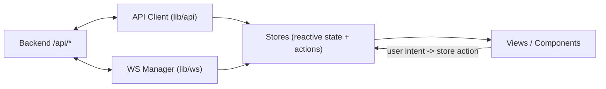
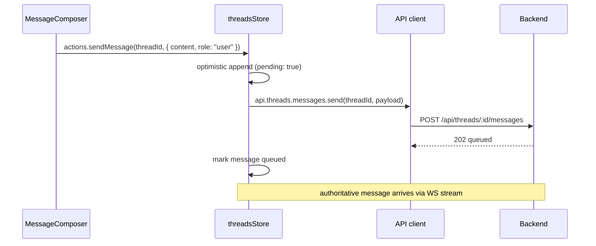
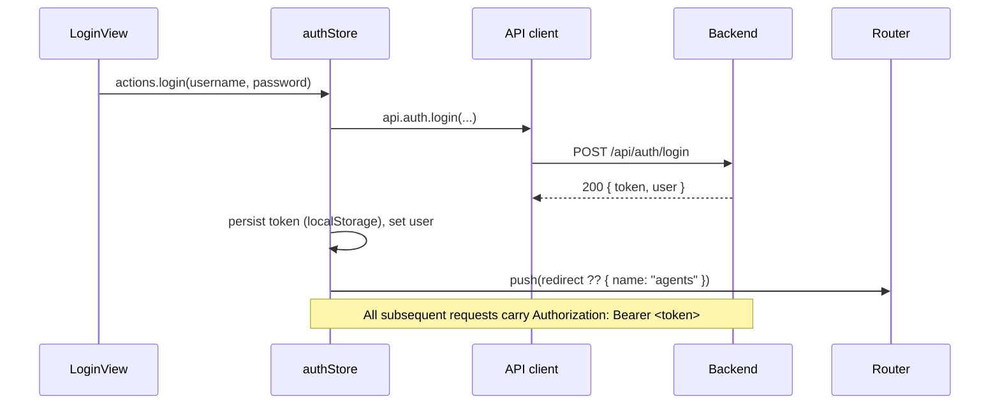
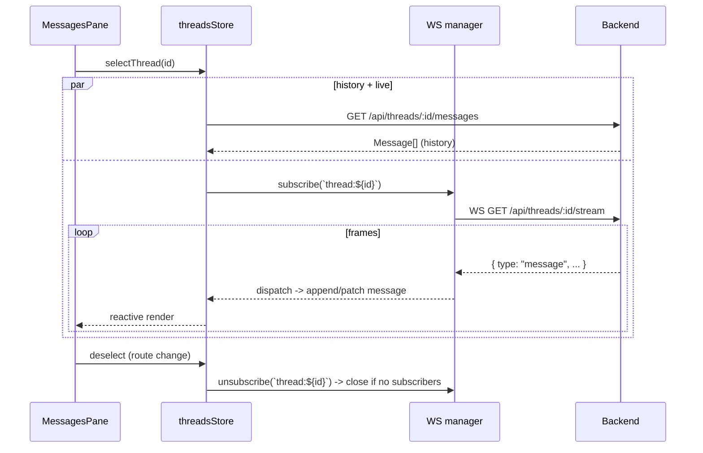
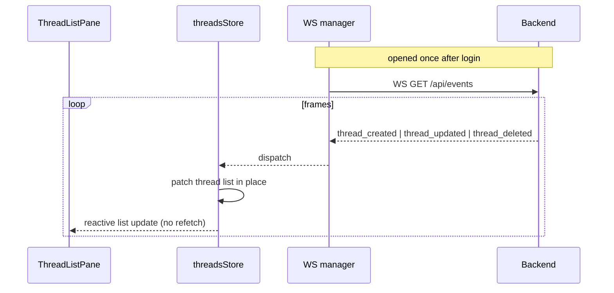
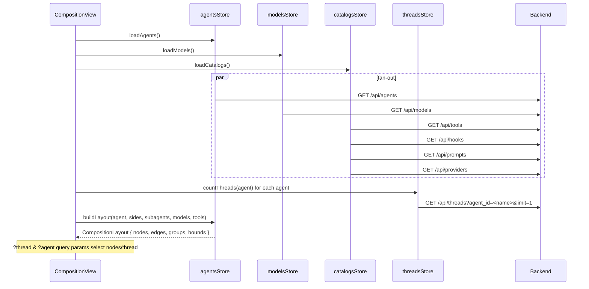

# swarmy_ui - Data Flow

How data moves through swarmy_ui: API client -> stores -> components -> views, and back. Plus the WebSocket streaming flows.

## 1. The One Rule

**Only stores talk to the network.** Components read reactive store state and call store actions. Views never call `fetch`, the API client, or the WebSocket manager directly. This keeps the entire UI layer replaceable: a new skin mounts on the same stores and sees identical data.



## 2. REST flow (read)

```mermaid
sequenceDiagram
    participant V as View (e.g. ModelsView)
    participant S as modelsStore
    participant C as API client
    participant B as Backend

    V->>S: onMounted -> actions.loadModels()
    S->>S: state.loading = true
    S->>C: api.models.list()
    C->>B: GET /api/models (Authorization: Bearer)
    B-->>C: 200 { models: ModelSummary[] }
    C-->>S: typed result
    S->>S: state.models = result; loading = false
    S-->>V: reactive re-render (computed selectors)
```

Notes:

- Errors are normalized in the client into `ApiError { status, code, message }`. Stores catch and write `state.error`; views render `UiAlertBox` from it.
- A 401 from any `/api/*` call (except `/api/auth/*`) triggers the global unauthorized handler: clear token, redirect to login.
- List endpoints are paginated (`limit`/`offset` or `page`/`perPage`); stores keep the pagination cursor, not components.

## 3. REST flow (write)



Writes are optimistic where the UI benefits (messages, variable edits), with the WebSocket stream as the source of truth that reconciles.

## 4. Auth flow



Session check: on boot and on every guarded navigation, `authStore.checkSession()` calls `GET /api/auth/me`. The result is cached per boot to avoid a request storm.

## 5. WebSocket streaming flows

The WS manager owns connections: one socket per endpoint, exponential-backoff reconnect, topic-based fan-out to stores. Auth token is sent during the upgrade handshake.

### 5a. Thread message stream



### 5b. Global events stream (thread registry)



### 5c. Other streams

| Endpoint | Store | Use |
|----------|-------|-----|
| `/api/threads/:id/bridge` | threadsStore (hosted only) | Client-tool bridge: forward tool calls to a connected CLI |
| `/api/users/me/stream` | uiStore | Per-user notifications and state frames |
| `/api/users/:id/stream` | usersStore | Admin observation of a user stream |
| `/api/users/me/hub` | uiStore | Persistent hub socket for daemon wake signals |

### 5d. Logs

Logs are REST-first: `GET /api/threads/:id/logs` polled on an interval while LogsPane is visible (with `DateFilterDropdown` range). The endpoint supports an optional WS upgrade for live tailing; the pane switches to it when permission allows. `LogDetails` fetches `/api/threads/:id/logs/:logId` (and `/inspect/:provider`) on demand.

## 6. CompositionView load flow

The heaviest view. Everything loads in parallel on mount; the canvas renders as soon as the layout inputs resolve.



## 7. URL synchronization

Deep-link state (`?agent=`, `?thread=` on `/agents`) is synced both ways:

- Route -> store: on navigation, stores read query params and select the agent/thread.
- Store -> route: selection changes call `router.replace({ query })` (never `push`, to avoid history spam).

The draft thread sentinel `__draft_new_thread__` appears in the URL for unsaved threads.

## 8. Store inventory and their endpoints

| Store | Reads | Writes | Streams |
|-------|-------|--------|---------|
| authStore | `/api/auth/me`, `/api/auth/config`, `/api/auth/bootstrap` | `/api/auth/login`, `/api/auth/logout` | - |
| agentsStore | `/api/agents`, `/api/agents/:name`, `/api/agents/:name/tenvs`, `/api/variables/agents/:name` | via pack/unpack | `/api/events` |
| threadsStore | `/api/threads*`, `/api/threads/:id/{messages,logs,cost,effects,kv,fs,subagents,...}` | create/patch/delete thread, messages, effects run/cancel, stop, continue, revive, kv, fs | `/api/threads/:id/stream`, `/api/threads/:id/bridge`, `/api/events` |
| modelsStore | `/api/models*`, `/api/providers`, `/api/providers/:name/tools` | `/api/models/available`, `/api/models/capabilities`, `/api/models/endpoints` | - |
| catalogsStore | `/api/prompts*`, `/api/tools*`, `/api/hooks`, `/api/skills*` | prompts/tools/skills CRUD | - |
| marketplaceStore | `/api/pack/:agentName/{analyze,metadata,packed-info}`, `/api/unpack/:packageId/analyze`, `/api/platform/**` | `/api/pack/:agentName`, `/publish`, `/api/unpack/:packageId` | - |
| usersStore | `/api/users*` | users CRUD, env patch | `/api/users/me/stream`, `/api/users/:id/stream`, `/api/users/me/hub` |
| variablesStore | `/api/users/me/env`, `/api/envs/instance` | PATCH env endpoints | - |
| uiStore | - | - | notifications from `/api/users/me/stream` |
