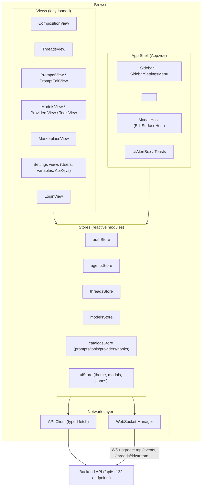
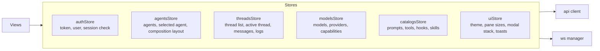
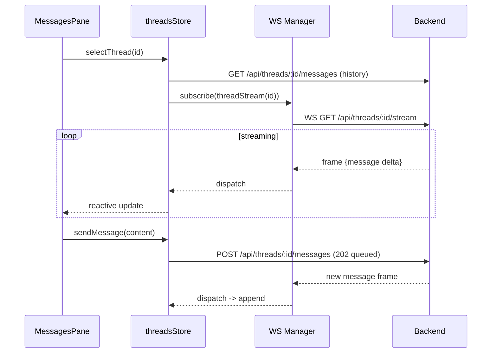
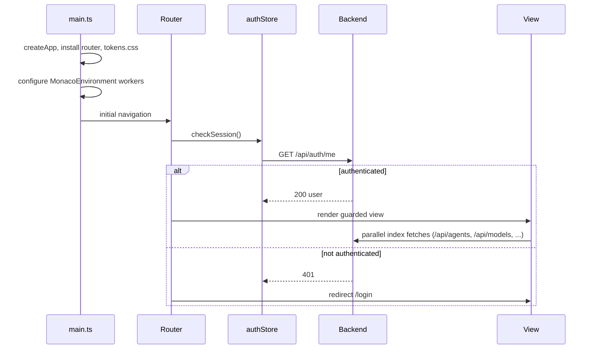

# swarmy_ui - System Architecture Overview

swarmy_ui is a single-page admin application for building, composing, and operating AI agents. It provides a visual composition canvas for agent graphs, a thread inspector for live conversations, and CRUD views for prompts, models, providers, tools, users, variables, API keys, and a package marketplace.

This document is the top-level architecture map. It is written so a developer can build the entire application from scratch using only this folder of docs plus the API contract.

## 1. Technology Stack

| Layer | Choice | Why |
|-------|--------|-----|
| Framework | Vue 3 (Composition API, `<script setup>`) | Reactivity model fits fine-grained streaming updates; small runtime |
| Build | Vite | Fast dev server, native ESM worker imports for Monaco, `?worker` support |
| Language | TypeScript | End-to-end type safety from API client to components |
| Styling | Tailwind CSS v4 (`@theme` tokens) | Utility-first, token-driven, trivially re-themable (see ADR-001) |
| Forms | shadcn-vue (Reka UI) + VeeValidate + Zod | Owned copy-paste components, schema-first validation (see ADR-002) |
| Code editor | `@guolao/vue-monaco-editor` | Vue 3 Monaco wrapper with Vite worker wiring (see ADR-003) |
| Syntax highlighting | Shiki `createHighlighterCore` (fine-grained) | Tree-shaken langs/themes, singleton highlighter (see ADR-004) |
| Composition canvas | Custom SVG canvas (own code) | Full control, no graph library lock-in (see ADR-005) |
| State | Hand-rolled reactive stores (`reactive` + `computed`) | No heavy framework; stores are plain modules (see ADR-006) |
| Router | `vue-router` 4 | 15 named routes, auth guards, lazy loading |
| API | Typed fetch client generated from the API contract | 132 endpoints, one function per endpoint |
| Realtime | WebSocket client with auto-reconnect | 6 streaming endpoints (thread stream, events, user streams, bridge, hub) |

## 2. High-Level Diagram



## 3. App Shell

`App.vue` is the root. It owns the permanent chrome and nothing else:

```
App.vue
  Sidebar.vue                    - global nav (agents, threads, prompts, models, providers, tools, marketplace)
    SidebarAgentOptionRow        - per-agent quick links in the nav
    SidebarSettingsMenu          - flyout for settings routes
  <router-view>                  - the active view (lazy chunk)
  EditSurfaceHost.vue            - modal/slide-pane host, mounts edit surfaces imperatively
  WarningBanner.vue              - global warning (e.g. unreachable backend)
  Loader.vue                     - boot spinner while session check resolves
```

Shell rules:

- The shell contains **no business logic**. It reads from `uiStore` and `authStore` only.
- The shell is styled purely with tokens (see ADR-007). Swapping the skin of the app means swapping token values and, at most, swapping the `Ui*` primitive components.
- `LoginView` renders outside the sidebar layout: the router applies a bare layout for `meta.public` routes.

## 4. Routing

15 named routes under `createWebHistory(base)` where `base = import.meta.env.VITE_BASE_PATH || "/"`. Auth is enforced by a global `beforeEach` guard that calls `authStore.checkSession()` (`GET /api/auth/me`). A global fetch-level 401 handler redirects to login. Full details in [routing.md](./routing.md).

## 5. State Management

State lives in plain TypeScript modules under `src/stores/`, each exporting a `reactive(...)` object plus actions. There is no Pinia/Vuex dependency (see ADR-006).



Conventions:

- Stores expose `state` (reactive), derived `computed` getters, and async `actions`.
- Only stores call the API client or WebSocket manager. Components never fetch directly.
- Cross-store access is allowed one-way: feature stores may read `authStore` and `uiStore`, never the reverse.

## 6. API Layer

`src/lib/api/` contains:

- `client.ts` - a thin `fetch` wrapper: base URL, JSON handling, Bearer token injection, error normalization, and a global `onUnauthorized` hook used by the router.
- `generated/` - one typed function per endpoint from the API contract (132 endpoints). Example signatures:

```ts
api.threads.list({ limit, offset, agent_id, search, startDate, endDate })
api.threads.create({ agent_id, initial_messages?, env?, env_types? })
api.threads.messages.send(id, { content, role, attachments?, silent? })
api.models.available({ provider, filter?, page?, perPage? })
api.pack.publish(agentName, { ... })
```

Auth model: `POST /api/auth/login` returns `{ token, user }`. The token is stored client-side (localStorage) and sent as `Authorization: Bearer`. `GET /api/auth/me` validates the session on boot and on every guarded navigation.

## 7. WebSocket Streaming

`src/lib/ws/manager.ts` manages sockets with exponential-backoff reconnect and per-topic subscription. Six streaming endpoints:

| Endpoint | Purpose | Consumed by |
|----------|---------|-------------|
| `GET /api/events` | Global thread registry events (`thread_created`, `thread_updated`, `thread_deleted`) | threadsStore, ThreadsView list |
| `GET /api/threads/:id/stream` | Live message stream for one thread | MessagesPane |
| `GET /api/threads/:id/bridge` | Client-tool bridge (hosted only) | ThreadDeveloperToolsCard |
| `GET /api/users/me/stream` | Per-user event stream | uiStore notifications |
| `GET /api/users/:id/stream` | Admin view of a user's stream | UsersView |
| `GET /api/users/me/hub` | Persistent hub socket | wake signals |

Thread logs (`GET /api/threads/:id/logs`) are consumed via REST polling by default; the endpoint also supports an optional WS upgrade for live tailing.



Full flows in [data-flow.md](./data-flow.md).

## 8. Component Tree

Roughly 170 components organized in five layers (details in [component-tree.md](./component-tree.md)):

1. **Shell** - App, Sidebar, banners, loaders.
2. **Views** - 15 route-level components.
3. **Shared primitives (`Ui*`)** - UiButton, UiIconButton, UiBadge, UiTooltip, UiAlertBox, UiFormField, UiLabel, UiHelpText, UiErrorText, UiDropdownPanel, UiMenuItem, UiEmptyState, UiCodeBlock. These are shadcn-vue-style components: vendored source in `src/components/ui/`, built on **Reka UI headless primitives** (accessibility, focus management, keyboard handling) and styled with Tailwind tokens. **This is the skin layer**: every visual component above it is built from these primitives plus tokens.
4. **Modals / edit surfaces** - Modal, ModalCard, ModalTabs, AgentModal, ModelModal, PromptModal, PackModal, PublishModal, UnpackModal, CreateThreadModal, ConfirmDialog, PromptMentionDialog, EditSurface*.
5. **Canvas** - CompositionCanvas, CanvasGrid, CanvasEdges, CanvasControls, AgentNode, ModelNode, ToolNode, HookNode, SidePromptNode, StructureTree.

## 9. Swappability (core principle)

Every architectural boundary in this document exists so the **UI layer can be replaced without touching functionality**:

- **Theme** - all colors, radii, shadows, and fonts resolve to CSS custom properties declared in Tailwind v4 `@theme` blocks (ADR-001). A new theme is a new token file.
- **Component skin** - views never hardcode styling of primitives; they compose `Ui*` components. Reskinning the app means editing the `Ui*` layer only.
- **Layout** - pane sizes and the 3-column composition layout are driven by `uiStore` values and CSS classes, not baked into view logic.
- **Domain adapters** - components receive typed props (e.g. `ModelNodeData`) and emit events; they never call the API. A completely different skin can be mounted on the same stores and API layer.

The full manifesto is in [docs/design/theming.md](../design/theming.md) and ADR-007.

## 10. Boot Sequence



## 11. Directory Layout

```
swarmy_ui/
  src/
    main.ts
    App.vue
    assets/
      tokens.css            - Tailwind v4 @theme token layers
      themes/               - swappable theme files
    lib/
      api/                  - client + generated endpoint functions
      ws/                   - WebSocket manager
      shiki/                - highlighter singleton
    stores/                 - reactive stores
    router/index.ts
    views/                  - 15 route views (lazy chunks)
    components/
      shell/                - App chrome
      ui/                   - Ui* primitives (the skin layer)
      modals/               - dialogs and edit surfaces
      canvas/               - composition canvas
      forms/                - form fields, panes, selectors
      data/                 - DataTable, JsonViewer, trees, logs
    composables/            - useShikiHighlighter, usePanZoom, useThreadStream, ...
  docs/
    architecture/           - this folder
    adr/                    - decision records
    design/                 - theming manifesto
```

## 12. Build & Serving Notes

- Dev base path `/`, production base path configurable via `VITE_BASE_PATH` (e.g. `/agents/`). Never hardcode `/`.
- Monaco workers are wired with Vite `?worker` imports in `main.ts` (do not combine with a Monaco Vite plugin - pick one).
- Views are lazy-loaded route chunks; Monaco and Shiki are only reachable from editor/highlight chunks so the main bundle stays small.
