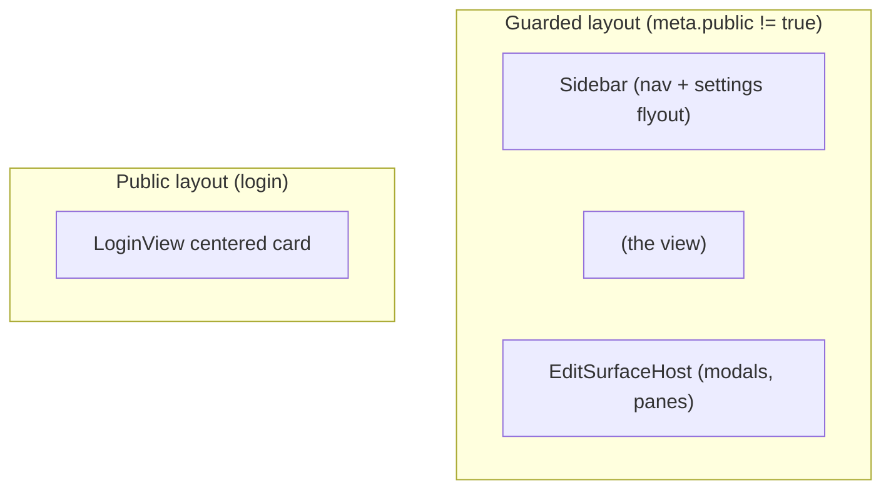

# swarmy_ui - Routing

14 named routes. All routes except `/login` require an authenticated session; `/users` additionally requires the admin role.

## Route Map

| Path | Name | Component | Auth |
|------|------|-----------|------|
| `/` | - | redirect to `agents` | guarded |
| `/login` | `login` | `LoginView` | public |
| `/agents` | `agents` | `AgentsView` | required |
| `/agents/:id` | `composition` | `CompositionView` | required |
| `/threads` | `threads` | `ThreadsView` | required |
| `/threads/:id` | `thread-inspector` | `ThreadInspectorView` | required |
| `/models` | `models` | `ModelsView` | required |
| `/providers` | `providers` | `ProvidersView` | required |
| `/tools` | `tools` | `ToolsView` | required |
| `/prompts` | `prompts` | `PromptsView` | required |
| `/prompts/:id` | `prompt-edit` | `PromptEditView` | required |
| `/marketplace` | `marketplace` | `MarketplaceView` | required |
| `/users` | `users` | `UsersView` | admin only |
| `/api-keys` | `api-keys` | `ApiKeysView` | required |
| `/variables` | `variables` | `VariablesView` | required |

(14 named routes plus the root redirect.)

## Router Definition

```ts
// src/router/index.ts
import { createRouter, createWebHistory } from "vue-router";
import { useAuthStore } from "@/stores/auth";
import { setUnauthorizedHandler } from "@/lib/api";

const base = import.meta.env.VITE_BASE_PATH || "/";

const router = createRouter({
  history: createWebHistory(base),
  routes: [
    { path: "/", redirect: { name: "agents" } },
    { path: "/login", name: "login", meta: { public: true },
      component: () => import("@/views/LoginView.vue") },
    { path: "/agents", name: "agents",
      component: () => import("@/views/AgentsView.vue") },
    { path: "/agents/:id", name: "composition",
      component: () => import("@/views/CompositionView.vue") },
    { path: "/threads", name: "threads",
      component: () => import("@/views/ThreadsView.vue") },
    { path: "/threads/:id", name: "thread-inspector",
      component: () => import("@/views/ThreadInspectorView.vue") },
    { path: "/models", name: "models",
      component: () => import("@/views/ModelsView.vue") },
    { path: "/providers", name: "providers",
      component: () => import("@/views/ProvidersView.vue") },
    { path: "/tools", name: "tools",
      component: () => import("@/views/ToolsView.vue") },
    { path: "/prompts", name: "prompts",
      component: () => import("@/views/PromptsView.vue") },
    { path: "/prompts/:id", name: "prompt-edit",
      component: () => import("@/views/PromptEditView.vue") },
    { path: "/marketplace", name: "marketplace",
      component: () => import("@/views/MarketplaceView.vue") },
    { path: "/users", name: "users", meta: { role: "admin" },
      component: () => import("@/views/UsersView.vue") },
    { path: "/api-keys", name: "api-keys",
      component: () => import("@/views/ApiKeysView.vue") },
    { path: "/variables", name: "variables",
      component: () => import("@/views/VariablesView.vue") },
  ],
});
```

## Auth Guards

```ts
setUnauthorizedHandler(() => {
  // Called by the API client on any /api/* 401 (except /api/auth/*)
  const auth = useAuthStore();
  auth.setToken(null);
  auth.user.value = null;
  router.push({ name: "login" });
});

router.beforeEach(async (to) => {
  const auth = useAuthStore();
  if (!to.meta.public) {
    const ok = await auth.checkSession(); // GET /api/auth/me, cached per boot
    if (!ok) {
      return { name: "login", query: { redirect: to.fullPath } };
    }
  }
  if (to.meta.role === "admin" && auth.user.value?.role !== "admin") {
    return { path: "/" };
  }
  if (to.name === "login" && auth.isAuthenticated.value) {
    return { name: "agents" };
  }
});
```

Rules:

- Only `/login` carries `meta.public`. Everything else is guarded by default.
- `/users` carries `meta.role = "admin"`. The guard checks `role === "admin"` from `GET /api/auth/me`; non-admin users are redirected to `/` before the view renders.
- The original destination is preserved in `?redirect=` and honored after login, so deep links like `/agents/:id?thread=<uuid>` survive the auth round trip.
- The 401 handler lives in the API client, not the router, so expired sessions mid-session also bounce to login.

## Layout Application

Two route layouts, both owned by the shell (not by views):



`App.vue` selects the layout by `route.meta.public`. Views never render their own sidebar or modal host. This keeps the shell swappable: a different chrome (top bar instead of sidebar, different nav grouping) is a change to `App.vue` and the shell components only, never to a view.

## Lazy Loading & Code Splitting

- Every view is a dynamic `import()` chunk. The main bundle contains only the shell, router, stores, and shared primitives.
- Heavy dependencies are reachable only from their view chunks:
  - Monaco: PromptEditView, PromptModal, JsonViewer-adjacent editors.
  - Shiki: code highlight chunks (ThreadInspectorView, CodeBlock).
  - Canvas: CompositionView only.

## Deep Link Contract (`/agents/:id`)

- `?thread=<uuid>` - selects the active thread in the thread pane; synced bidirectionally with `router.replace({ query })`.
- `?node=<id>` - optional; selects the focused canvas node and opens its inspector pane, same sync behavior.
- Deep links survive the auth round trip: the guard preserves the full path and query in the login `?redirect=` param.

## Base Path

Dev serves at `/`; production may serve under a sub-path (e.g. `/agents/`). Always use `import.meta.env.VITE_BASE_PATH` for `createWebHistory` and never hardcode absolute asset paths.
