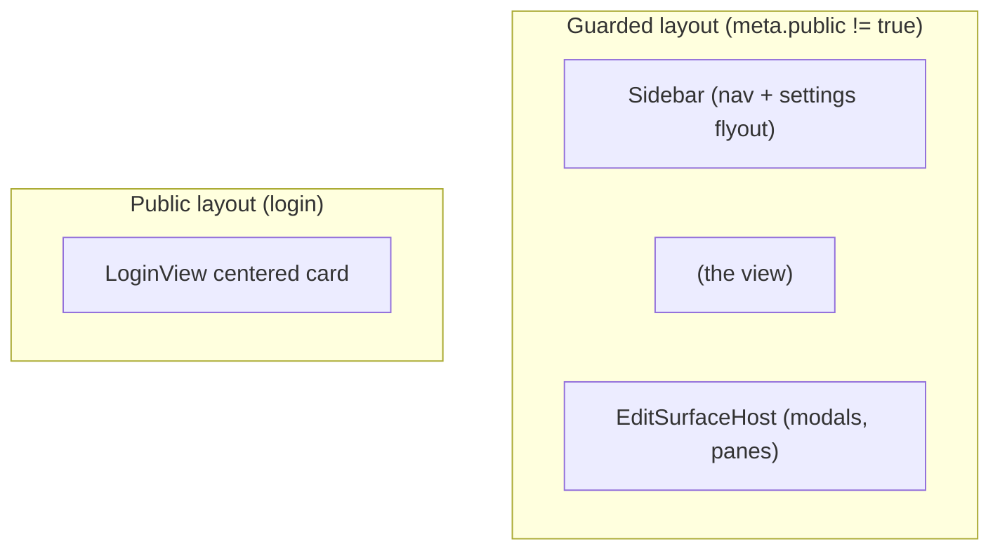

# swarmy_ui - Routing

15 named routes plus a root redirect, transcribed from the live app. All routes
except `/login` require an authenticated session.

**Corrected 2026-07-30 against the capture.** The earlier draft listed
`/agents/:id` (`composition`), `/threads/:id` (`thread-inspector`), and
top-level `/users`, `/api-keys`, `/variables`. None of those paths exist. The
live app puts agent and thread selection in the **query string** and nests the
settings pages under `/settings/*`.

## Route Map

| Path | Name | View id | Auth |
|------|------|---------|------|
| `/` | - | redirect to `agents` | guarded |
| `/login` | `login` | `login` | public |
| `/agents` | `agents` | `composition` | required |
| `/threads` | `threads` | `threads` | required |
| `/threads/:id` | `thread-detail` | `threads` | required |
| `/prompts` | `prompts` | `prompts` | required |
| `/prompts/:id` | `prompt-edit` | `prompt-edit` | required |
| `/models` | `models` | `models` | required |
| `/providers` | `providers` | `providers` | required |
| `/tools` | `tools` | `tools` | required |
| `/marketplace` | `marketplace` | `marketplace` | required |
| `/marketplace/:name(.*)` | `marketplace-package` | `marketplace` | required |
| `/settings/users` | `users` | `users` | required |
| `/settings/my-variables` | `my-variables` | `variables` | required |
| `/settings/instance-variables` | `instance-variables` | `variables` | required |
| `/settings/api-keys` | `api-keys` | `api-keys` | required |

Notes:

- `/agents` is the **cascade** shell, not an agents list page. `/threads` is the
  same shell with the Agents section absent, which is why both resolve to shells
  that share every pane component.
- `/threads/:id` and `/threads` share one view id; the param only selects.
- `/prompts/:id` renders the prompts list with the Edit Prompt modal open over
  it.
- No route carries an admin-only flag in the live app. The settings pages are
  reachable from the gear popover for any authenticated user; server-side
  authorization is the real gate.

## Router Definition

Routes are **data**, and their components come from the view registry rather
than from static imports (ADR-008). See `src/router/routes.ts` and
`src/router/index.ts`.

```ts
// src/router/routes.ts (excerpt)
export const routeDefs: RouteDef[] = [
  { path: "/login", name: "login", view: "login", meta: { public: true } },
  { path: "/agents", name: "agents", view: "composition" },
  { path: "/threads", name: "threads", view: "threads" },
  { path: "/threads/:id", name: "thread-detail", view: "threads" },
  // ...
];

// src/router/index.ts (excerpt)
component: () => {
  const loader = views.get(def.view);
  return loader ? loader() : Promise.resolve(unregisteredView(def.view));
},
```

A feature registers `views.register("<id>", () => import("./FooView.vue"))` from
its own plug; the route table gains at most one data line and no core file is
edited.

## Auth Guards

```ts
setUnauthorizedHandler(() => {
  // Called by the API client on any /api/* 401 (except /api/auth/*)
  const auth = useAuthStore();
  auth.setToken(null);
  auth.user.value = null;
  router.push({ name: "login" });
});

router.beforeEach(async (to) => {
  const auth = useAuthStore();
  if (!to.meta.public) {
    const ok = await auth.checkSession(); // GET /api/auth/me, cached per boot
    if (!ok) {
      return { name: "login", query: { redirect: to.fullPath } };
    }
  }
  if (to.name === "login" && auth.isAuthenticated.value) {
    return { name: "agents" };
  }
});
```

Rules:

- Only `/login` carries `meta.public`. Everything else is guarded by default.
- The original destination is preserved in `?redirect=` and honored after login, so deep links like `/agents?agent=<name>&thread=<uuid>` survive the auth round trip.
- The 401 handler lives in the API client, not the router, so expired sessions mid-session also bounce to login.

## Layout Application

Two route layouts, both owned by the shell (not by views):



`App.vue` selects the layout by `route.meta.public`. Views never render their own sidebar or modal host. This keeps the shell swappable: a different chrome (top bar instead of sidebar, different nav grouping) is a change to `App.vue` and the shell components only, never to a view.

## Lazy Loading & Code Splitting

- Every view is a dynamic `import()` chunk. The main bundle contains only the shell, router, stores, and shared primitives.
- Heavy dependencies are reachable only from their view chunks:
  - Monaco: PromptEditView, PromptModal, JsonViewer-adjacent editors.
  - Shiki: code highlight chunks (the inspector panes, UiCodeBlock).
  - Canvas: the `composition` view chunk only.
- Because a registry value *is* a dynamic import, view code-splitting is a
  property of the registration seam rather than something each route repeats.

## Deep Link Contract (`/agents`)

Selection lives entirely in the query string; the path never changes.

- `?agent=<agent_name>` - selects the agent and mounts cascade sections 2 and 3.
- `?thread=<uuid>` - selects the active thread; binds the Messages and Inspector panes.
- `?node=<id>` - optional; focuses a canvas node.
- `?tab=<id>` - optional; the active inspector tab.

All four are synced with `router.replace({ query })` so selection does not fill
the history stack. The canonical deep link used throughout the capture is
`/agents?agent=order_support_agent&thread=4ae6b87e-9270-442a-9977-91b448ef73ea`.
Deep links survive the auth round trip via the login `?redirect=` param.

## Base Path

Dev serves at `/`; production may serve under a sub-path (e.g. `/agents/`). Always use `import.meta.env.VITE_BASE_PATH` for `createWebHistory` and never hardcode absolute asset paths.
