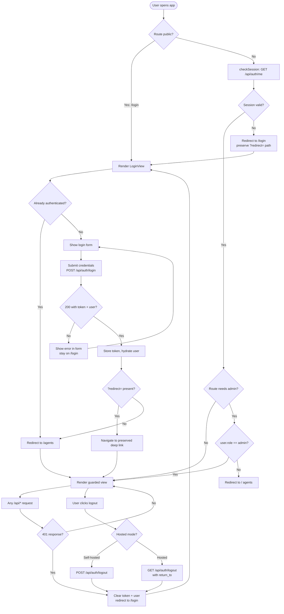
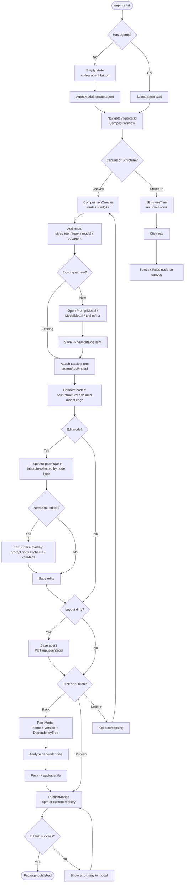
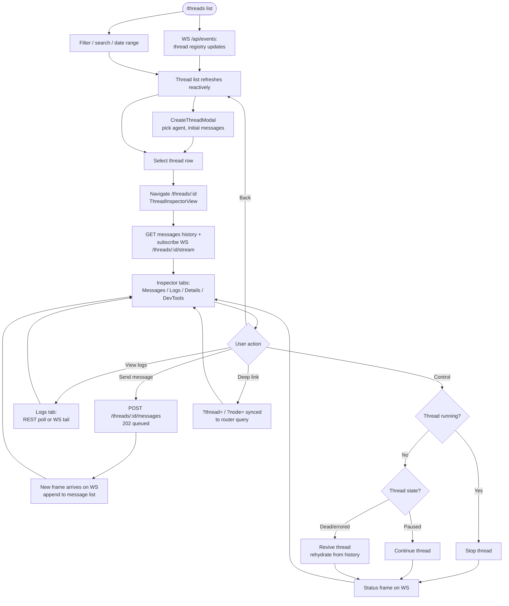
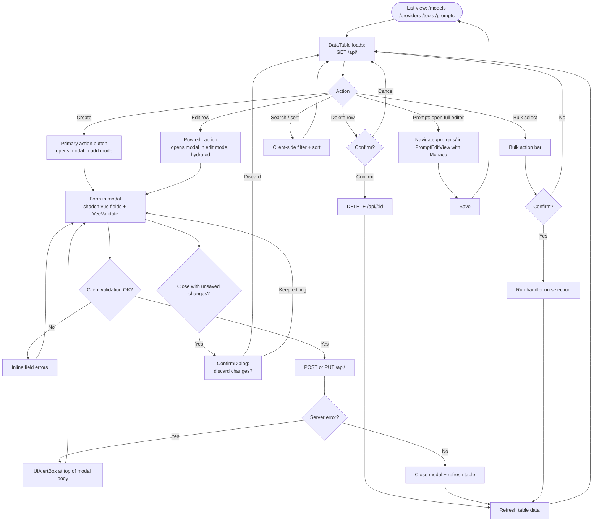
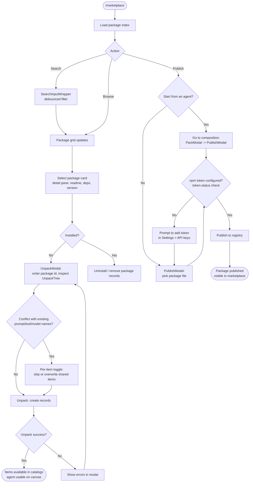
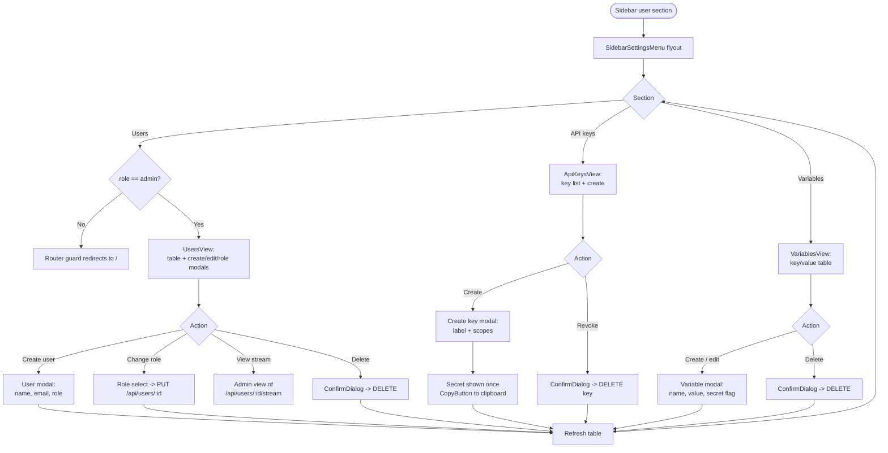
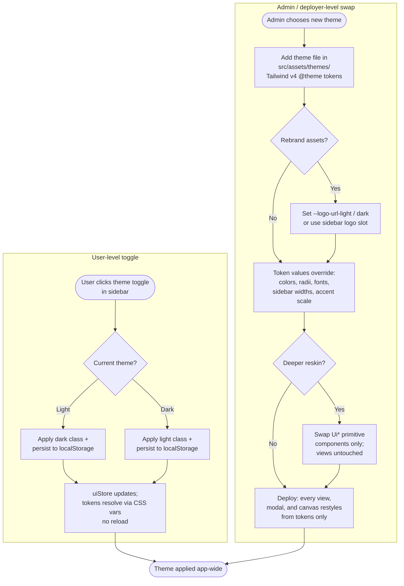

# swarmy_ui - User Flows

Project: **swarmy_ui**. Mermaid flowcharts for the primary user journeys. Decision nodes are drawn as `{ }` branches; every flow assumes the routing contract in [routing.md](./routing.md) (all routes guarded except `/login`, `/users` admin-only).

## 1. Authentication Flow

Covers app boot, login, session validation, and logout.

## 2. Agent Composition Flow

From the agents list to a saved, packed, published agent.

## 3. Thread Inspection Flow

From the threads list to live inspection and intervention.

## 4. CRUD Management Flow

Shared flow for models, providers, tools, and prompts. All four views are DataTable + modal driven.

## 5. Marketplace Flow

Browse, install (unpack), and publish packages.

## 6. Settings Flow

Users, API keys, and variables management. `/users` is admin-only.

## 7. Theme Swap Flow

How a user toggles light/dark, and how an admin or deployer swaps the whole skin.

## Notes

- Every guarded navigation re-checks the session; a mid-session 401 anywhere in the API client bounces to `/login` via the global unauthorized handler.
- Deep links (`/agents/:id?thread=<uuid>&node=<id>`) survive the login round trip through the `?redirect=` query param.
- Modals with `hasChanges` always gate close behind a ConfirmDialog; this is uniform across ModelModal, PromptModal, and the CRUD edit surfaces.
