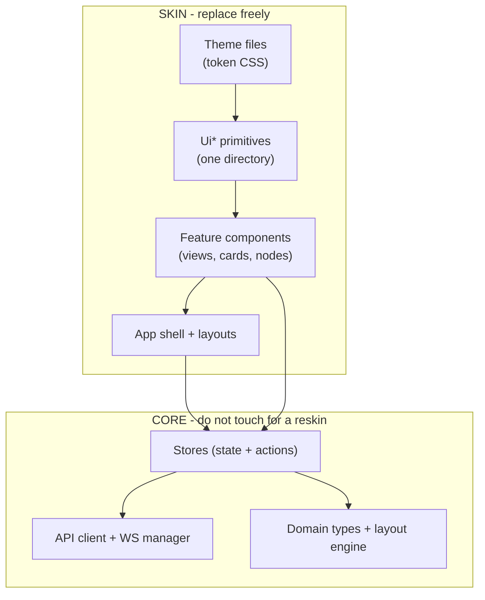

# swarmy_ui - Theming & Swappability Manifesto

This is the design document every developer should read before touching UI code. swarmy_ui is built so that **everything the user sees can be replaced without touching how the app works**.

Functionality is stable: API contract, stores, domain models, streaming flows. Appearance is a surface layered on top: tokens, primitives, layouts, shells. This document explains how each surface is swapped.

## 1. The mental model



Data always flows up from the core; styling always flows down from the skin. Nothing in the core imports anything from the skin.

## 2. The token system (change colors, fonts, density)

Three layers, all CSS custom properties in Tailwind v4 `@theme` blocks:

1. **Primitives** (`tokens.primitives.css`) - raw scales: `--accent-50..950` (purple brand ramp), `--color-neutral-*` (oklch grays), `--font-sans`, `--font-mono`, `--spacing`, `--radius-*`, shadow scale.
2. **Semantic** (`tokens.semantic.css`) - meaning: `--color-text`, `--color-background{,-soft,-mute}`, `--color-border{,-hover}`, and the composition family `--agents-accent-{surface-hover,surface-selected,surface-strong,surface-message,text,text-muted,border,ring}`. Dark values live under `:root.dark`.
3. **Component** (inside each `Ui*` primitive) - per-widget aliases (`--ui-button-bg`, ...) defaulting to semantic tokens.

Components only ever use semantic utilities (`bg-background-soft`, `text-agents-accent-text-muted`, `border-border`). Raw hex/oklch values in a component are a bug.

### Task: change the brand color

Edit the `--accent-*` scale and the `--agents-accent-*` aliases. Done. Every button, selected row, canvas edge, ring, and badge follows.

### Task: create a whole new theme

Create `src/assets/themes/my-theme.css`:

```css
@theme {
  /* redeclare primitives if needed */
  --accent-500: #0ea5e9;
  /* redeclare semantics */
  --color-background: #ffffff;
  --agents-accent-surface-selected: var(--accent-500);
  /* ... */
}
:root.dark {
  /* dark counterparts */
}
```

Import it after the defaults in `main.ts`. Zero component changes. A theme also declares its Shiki highlight pair (ADR-004) and its Monaco theme mapping (ADR-003), so code display and editors follow too.

### Task: dark mode

Class strategy: `.dark` on `<html>`, toggled by uiStore, persisted in localStorage. All dark values sit beside light values in the semantic layer - no separate dark stylesheet to drift out of sync.

## 3. The primitive layer (change how components look)

Every repeated visual element exists exactly once in `src/components/ui/`:

`UiButton, UiIconButton, UiBadge, UiTooltip, UiAlertBox, UiFormField, UiLabel, UiHelpText, UiErrorText, UiDropdownPanel, UiMenuItem, UiEmptyState, UiCodeBlock`

### Task: restyle every button in the app

Edit `UiButton.vue`. Its variants (`primary`, `ghost`, `danger`) and sizes read component tokens. Every call site updates.

### Task: make model cards look different

`ModelNode`, `ModelOptionRow`, and `MarketplaceCard` are feature components with typed props and events. Rewrite their templates and styles freely - keep the props/events contract and the stores, canvas, and views keep working unchanged. The contract is the functionality; the template is the skin.

## 4. Layout (change arrangement, not behavior)

- App chrome (sidebar vs top bar, nav grouping) lives in the shell only. Views never render their own chrome; the guarded/public layout choice is made by `App.vue` from `route.meta.public`.
- Pane geometry (the composition 3-column layout: structure tree 280px / 48px collapsed, messages column, logs column, inspector resizer) is driven by uiStore values and named CSS classes (`threads-col`, `messages-col`, `logs-col`, `thread-detail-resizer`). Change the numbers in one place.
- Modals vs slide panes: surfaces are mounted imperatively through `EditSurfaceHost` from the uiStore modal stack. Repositioning an edit surface from a centered dialog to a right-side drawer is a change to the host/shell components, never to the feature that opens it.

### Task: move from sidebar navigation to top navigation

Rewrite `Sidebar` -> `TopNav` in the shell, update `App.vue`'s guarded layout. No view, store, or route changes.

## 5. Full skin swap (the extreme case)

To ship a completely different-looking swarmy_ui on the same functionality:

1. New theme file (tokens).
2. Rewrite `src/components/ui/` (13 primitives).
3. Rewrite feature components and shell as desired, keeping props/events contracts.
4. Keep `src/stores`, `src/lib/api`, `src/lib/ws`, domain types, and the layout engine untouched.

Because every network call, stream subscription, and state transition lives below the component tree, the new skin is guaranteed the same behavior as the old one.

## 6. Rules that protect swappability

| # | Rule | Why |
|---|------|-----|
| 1 | No hardcoded colors/radii/fonts in components | Forces all appearance through tokens |
| 2 | Feature components compose `Ui*` primitives, never restyle raw elements | One place to reskin |
| 3 | Components never import `lib/api` or `lib/ws`; stores only | UI is a pure projection of state |
| 4 | Typed domain props in, intent events out | Appearance contract is separate from behavior |
| 5 | Views contain route wiring only | Shell and layout are swappable |
| 6 | Modals mounted via `EditSurfaceHost`, never inline | Presentation of surfaces is decoupled |
| 7 | Deep-link state synced via `router.replace` in stores | URL behavior survives any reskin |

## 7. Reference: token quick table

| Want to change... | Edit... |
|---|---|
| Brand accent | `--accent-*` + `--agents-accent-*` |
| App background/text | `--color-background*`, `--color-text` (light + `:root.dark`) |
| Borders | `--color-border`, `--color-border-hover` |
| Corner rounding | `--radius-*` |
| Shadows | shadow scale in primitives layer |
| Fonts | `--font-sans`, `--font-mono` |
| Spacing density | `--spacing` base unit (4px default) |
| JSON viewer colors | `--json-key/string/number/boolean/null` pairs |
| Code highlight theme | Shiki theme pair in the theme file |
| Monaco theme | Monaco theme mapping in `CodeEditor.vue` |
| One widget only | its component token in the `Ui*` file |

## 8. What is NOT skin

- API endpoint paths, request/response shapes (the contract).
- WebSocket endpoints and frame handling.
- Auth flow (login, session check, 401 redirect).
- Deep-link query params (`?agent=`, `?thread=`) and route names.
- The composition domain model (`CompositionLayout`, node/edge/group types) and `buildLayout`.
- Store action names and state shapes.

These are functionality. Changing them is a product change, not a reskin, and these docs + the ADRs govern how to do that deliberately.
